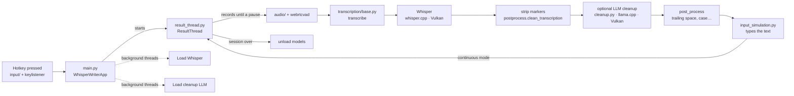

# Architecture

A guide for contributors. Users do not need this page.

## What happens during one dictation

1. A global **hotkey** (`input/`, `keylistener.py`) tells `WhisperWriterApp` (`main.py`) to start a dictation.
2. `main.py` creates a `ResultThread` and, in background threads, **loads** the Whisper model and (if enabled) the
   cleanup model, so loading overlaps with the user speaking.
3. `ResultThread` ([audio pipeline](audio-processing.md)) records until the recording mode says stop and emits the audio.
4. `transcription.transcribe()` turns audio into text (local model or API), removes Whisper's `[BLANK_AUDIO]`-style
   markers, optionally runs the cleanup LLM, and applies post-processing.
5. `input_simulation.py` types the text. In `continuous` mode a new `ResultThread` starts immediately.
6. When the session really ends (not just between continuous segments) `main.py` **unloads** the models.

## Module map

| Path | Responsibility |
|---|---|
| `src/launcher.py` | Entry point of the `.exe`; parses `--tray / --startup / --show`. |
| `src/main.py` | `WhisperWriterApp`: Qt app, tray, windows; wires hotkey → `ResultThread` → typing; model load/unload timing. |
| `src/result_thread.py` | `ResultThread` (QThread): one dictation = record → transcribe → emit text. |
| `src/audio/` | Microphone stream (`stream.py`), device queries (`device.py`), resampling (`resampler.py`). |
| `src/input/`, `src/keylistener.py` | Global hotkey detection; backends for Windows/pynput and Linux/evdev. |
| `src/input_simulation.py` | Typing the result (`pynput`, or `ydotool` / `dotool` on Linux). |
| `src/transcription/base.py` | `transcribe()`: the pipeline in step 4 above. |
| `src/transcription/model_factory.py` | `ManagedModel` (lazy load / thread-safe unload) and `_load_model()` choosing the engine from `local.device`. |
| `src/transcription/whispercpp.py` | whisper.cpp backend (Vulkan): model resolution/download, `transcribe`, `close`. Mimics faster-whisper's return shape so callers do not care. |
| `src/transcription/cleanup.py` | `TranscriptCleaner`: optional LLM cleanup with output sanity checks. |
| `src/transcription/downloads.py` | Model cache folder and the console-safe downloader (no `tqdm`: it crashes without a console). |
| `src/transcription/postprocess.py` | Marker stripping and final text tweaks. |
| `src/transcription/api.py` | OpenAI-compatible API transcription. |
| `src/core/config/` | `ConfigManager`: merges `config_schema.yaml` defaults with the user's `config.yaml`. |
| `src/config_schema.yaml` | **Every setting**: default, type, options, description. The Settings UI and `docs/configuration.md` are generated from it. |
| `src/ui/` | Qt windows: main, settings (built automatically from the schema), status. |
| `src/tray_launcher.py` | Tray icon and the Windows auto-start shortcut. |

## Design decisions worth knowing

* **Engines.** `local.device = vulkan` uses whisper.cpp (any GPU); other values use faster-whisper. Both are wrapped so
  `transcribe_local` can call `model.transcribe(...)` and read `(segments, info)` either way.
* **One lifecycle object.** `ManagedModel` owns the model, a lock, `load()`, `unload()` and a `transcribe()` that
  reloads on demand. Unloading waits for an in-flight transcription; faster-whisper's lazy segment generator is
  consumed inside the lock so a model is never freed while still being read.
* **Cleanup is best-effort.** Any failure or implausible output falls back to the original text; the pipeline must
  never get worse than "no cleanup".
* **Windowed-exe safety.** The packaged app has no console, so `sys.stderr` is `None`. Code must not assume a console
  (this is why downloads avoid `tqdm`, and why errors go through `logging`, not `traceback.print_exc()`).
* **Settings come from the schema.** To add a setting, add it to `config_schema.yaml` (the Settings window picks it up
  automatically), read it with `ConfigManager.get_config_value(...)`, then run
  `uv run python scripts/generate_config_docs.py`.
* **Two copies of ggml.** whisper.cpp and llama.cpp each carry their own ggml. They coexist because their DLLs have
  different file names and live in different folders; keep it that way when packaging (see `whisper-writer.spec`).

## Tooling

| Command | Purpose |
|---|---|
| `scripts\setup.ps1` | Create the environment and build the GPU wheels. |
| `scripts\build.ps1` | Build the `.exe` (keeps `config.yaml`). |
| `uv run python scripts/check_gpu.py` | Verify GPU support is installed. |
| `uv run python scripts/generate_config_docs.py` | Regenerate `docs/configuration.md`. |
| `uv run ruff check src` | Lint (some older files still have findings; keep new code clean). |

There is no automated test suite yet; contributions that add one (the transcription pipeline and `postprocess` are
easy to test without a GPU) are very welcome.
